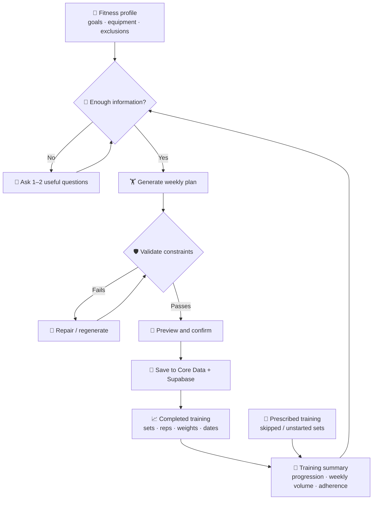

# 🏋️ AI Workout Generator — Improvement Roadmap

> **Status:** Planning · **Scope:** workout generation, personalisation, history, validation and feedback  
> **Audit baseline:** 26 October 2026 · [AIWorkoutGen](https://github.com/peterxie1311/AIWorkoutGen)  
> **Goal:** Turn a functional GPT workout generator into an evidence-informed, adaptive training planner.

> [!IMPORTANT]
> This is a **to-do list**, not an implementation. Audit findings come from reading the Swift source and inspecting sample workout data. No clinical or training-effectiveness validation has been performed. Do not interpret incomplete/unstarted sets as failed training without checking session state.

## 🗺️ Visual overview



## 🎯 Priorities at a glance

| Priority | Area | Outcome |
|---|---|---|
| 🔴 P0 | Correct history and session lifecycle | AI receives real performed sessions, in the right order |
| 🔴 P0 | Profile + excluded exercises | Persistent user preferences respected |
| 🔴 P0 | Validation and secure key handling | Invalid/unsafe plans rejected; secrets protected |
| 🟠 P1 | Training metrics and progression | Data-driven load and volume decisions |
| 🟠 P1 | Stronger prompt and structured response | Consistent plans and reliable parsing |
| 🟡 P2 | Adaptive AI questions | Clarify only when useful |
| 🟡 P2 | UX and feedback loop | Transparent plans and better adherence |
| 🟢 P3 | Tests, observability and evaluation | Measurable quality improvements |

---

## 🔴 P0 — Fix correctness before improving intelligence

### 1. Training history selection
**Code:** `Workout/dataManagers/WorkoutSessionsManager.swift` → `createWorkoutPlan()`

- [ ] Sort *performed* sessions by actual start/completion date, not default `endTime`.
- [ ] Exclude generated-but-unstarted sessions from performance history.
- [ ] Preserve planned sets separately from performed sets; include completion flags and counts.
- [ ] Include session timestamps and an explicit state (`planned`, `in_progress`, `completed`, `abandoned`).
- [ ] Set a bounded lookback (e.g., last 4–8 weeks) and fall back gracefully for new users.
- [ ] Use deterministic ordering of exercises/sets when building the prompt.
- [ ] Ensure history only includes the authenticated user's records.

**Why:** Current code sorts by `endTime` and sends only `setrepArray.filter(\.completed)`; it loses skipped prescriptions and may mistake newly generated plans for recent workouts.

### 2. Fix generated-session lifecycle
**Code:** `WorkoutSessionsManager.swift` → `addWorkoutSession()`, `WorkoutAIViewController.swift`

- [ ] Stop initialising both `startTime` and `endTime` to `Date()` for future sessions.
- [ ] Define clear transitions: planned → started → finished / abandoned.
- [ ] Avoid relying on `startTime == endTime` to indicate session state.
- [ ] Persist creation, start and completion timestamps independently.
- [ ] Await session saves and report partial failures; don't launch independent unawaited `Task` blocks per generated session.
- [ ] Refresh the UI only after all expected sessions are saved.

### 3. Enforce preferences and training constraints
**Code:** `SettingsManager.swift`, `workoutAIService.swift`

- [ ] Automatically read and include `Exclude Workout` in every generation request.
- [ ] Add structured goals (primary muscles, hypertrophy/strength), training days, equipment, experience and session time budget.
- [ ] Store permanent preferences separately from temporary conditions (e.g., soreness today).
- [ ] Define allowed exercise IDs and aliases rather than relying only on free-text names.
- [ ] Validate generated exercises against exclusions *after* the model responds.
- [ ] Clarify how customisations override defaults and prevent conflicting rules.

### 4. Validate every AI response before saving
**Code:** `workoutAIService.swift` and new `WorkoutPlanValidator.swift`

- [ ] Validate requested session count, nonempty exercise lists, positive sets/reps and plausible rest times.
- [ ] Check excluded exercises, equipment availability and weight basis.
- [ ] Check muscle-group distribution and configurable weekly set-volume boundaries.
- [ ] Flag implausible jumps in load or total volume; ask/confirm instead of blindly saving.
- [ ] Reject duplicate exercises where accidental; allow intentional repeats across days.
- [ ] Return actionable validation errors and optionally attempt one bounded repair.
- [ ] Add a preview/approval step before persisting a generated plan.

### 5. Protect API credentials and user data
**Code:** `workoutAIService.swift`, `SettingsManager.swift`, Supabase policies

- [ ] Do not store a shared OpenAI secret in public tables or ship it embedded in the app.
- [ ] For user-supplied API keys, use iOS Keychain locally; if syncing secrets, design an authenticated encrypted server-side solution.
- [ ] Review Supabase Row Level Security for workout/session/set and nutrition tables and test cross-user access.
- [ ] Validate that authenticated DB operations are scoped to the current user.
- [ ] Remove raw prompt, API key and sensitive data from production logs.

---

## 🟠 P1 — Make the workout programming better

### 6. Build a deterministic training-summary layer
**Suggested file:** `Workout/dataManagers/TrainingAnalysisManager.swift`

- [ ] Aggregate **completed** hard sets per muscle group by rolling week.
- [ ] Track prescribed vs performed sets by exercise and by session.
- [ ] Calculate exercise progression from comparable reps, weight basis and effort; avoid comparing unlike machines.
- [ ] Track frequency, days since last muscle exposure and recent gaps in training.
- [ ] Distinguish poor adherence from fatigue or an intentionally shortened session.
- [ ] Track effort (RPE/RIR) if available; otherwise treat fatigue estimates as uncertain.
- [ ] Send concise computed metrics *plus* selected raw examples to the model.

**Example training summary (illustrative, not actual user data):**

```json
{
  "muscle_group": "chest",
  "completed_hard_sets_last_7_days": 10,
  "prescribed_sets_last_7_days": 12,
  "last_trained_days_ago": 3,
  "priority": "high",
  "progression_signal": "stable",
  "confidence": "medium"
}
```

### 7. Upgrade prompt and output contract
**Code:** `Workout/baseProjectHelpers/workoutAIService.swift`

- [ ] Explicitly instruct the model to plan **the whole week**, not independent unrelated sessions.
- [ ] Include goals, recovery constraints, available equipment, preferred and excluded exercises.
- [ ] Specify sensible progression and conservative increases based on completed performance.
- [ ] Use structured JSON output with schema enforcement where supported; keep decoder validation.
- [ ] Add target effort (`RIR` or `RPE`), exercise IDs, rationale and alternatives to the output DTO.
- [ ] Allow fractional loads where appropriate (current `weight: Int` loses 2.5 kg increments).
- [ ] Keep the model from inventing past performance or interpreting absent data as completed training.
- [ ] Distinguish plan generation from optional explanation text.
- [ ] Review model selection, request timeouts, retries, error handling and cost limits.

### 8. Standardise exercise identity
**Code:** `SetrepDTO`, `SetrepManager`, DB schema

- [ ] Introduce stable exercise IDs and canonical names.
- [ ] Map variants such as `Bench press` / `Bench Press` to the same movement where appropriate.
- [ ] Store primary/secondary muscles, equipment, movement pattern and load basis.
- [ ] Preserve historical display names while normalising analytics.
- [ ] Handle per-dumbbell, per-side, machine-stack, bodyweight and added-weight consistently.

---

## 🟡 P2 — Adaptive questions + user experience

### 9. Ask questions only when they can change the plan
**Suggested files:** `WorkoutQuestionDTO.swift`, `WorkoutQuestionViewController.swift`

- [ ] Introduce an AI decision result: `ready_to_generate` or `needs_input`.
- [ ] Limit to 1–2 high-value questions per normal generation (configurable).
- [ ] Use structured answer types: choice, multi-choice, number and free text.
- [ ] Explain briefly why each question matters.
- [ ] Never ask for information already known from settings or history.
- [ ] Let users skip nonessential questions.
- [ ] Store durable answers in the fitness profile and short-lived answers as session context.
- [ ] Prevent repeated question loops and provide a default plan if the user declines.

**Illustrative mobile question card:**

```text
┌─────────────────────────────────┐
│ 🤖 Quick check-in               │
│                                 │
│ Your leg sessions have recently │
│ had several unfinished sets.    │
│                                 │
│ What was the main reason?       │
│                                 │
│ ◯ Ran out of time               │
│ ◯ Too fatigued                  │
│ ◯ Didn't like the exercises     │
│ ◯ Something else                │
│                                 │
│ [Skip]              [Continue]  │
└─────────────────────────────────┘
```

### 10. Preview and explain the plan
- [ ] Show a weekly calendar, muscle coverage and estimated duration.
- [ ] Explain key changes since the last plan (e.g., reduced volume after repeated skips).
- [ ] Let users swap an exercise and regenerate only the affected portion.
- [ ] Make planned vs completed sets visually distinct.
- [ ] Ask for a short post-session reason when many sets were skipped (optional).

---

## 🟢 P3 — Evaluation, testing and release confidence

### 11. Test the generation pipeline
- [ ] Unit tests: empty history, duplicate names, unstarted sessions, missing dates and fractional weights.
- [ ] Unit tests: excluded exercises, impossible volumes, invalid JSON and missing fields.
- [ ] Integration tests: generation → validation → Core Data → Supabase → reload.
- [ ] Regression fixtures for realistic users (beginner, advanced, travel gym, limited equipment).
- [ ] Ensure tests never use a real API key or mutate production workout data.

### 12. Measure quality rather than guessing
- [ ] Track generated-plan acceptance, edits, swaps and regeneration frequency.
- [ ] Track adherence by **started** sessions, not all future plans.
- [ ] Compare exercise progression over 4–8 weeks with appropriate caveats.
- [ ] Record validation failures and user-reported reasons for skipped exercises.
- [ ] Review a small blinded set of plans against a documented programming rubric.
- [ ] Monitor token cost and latency per generation.

---

## 🏁 Suggested delivery milestones

```mermaid
gantt
    title Implementation sequence (relative effort, not dates)
    dateFormat X
    axisFormat %s
    section Foundation
    History + lifecycle          :a, 0, 2
    Preferences + security       :b, 1, 3
    Response validation          :c, 2, 3
    section Intelligence
    Training summary             :d, 4, 3
    Prompt + schema              :e, 6, 2
    section Experience
    Adaptive questions           :f, 8, 2
    Plan preview + feedback      :g, 9, 2
    section Quality
    Automated tests + metrics    :h, 4, 7
```



### Definition of done — first release

- [ ] Generated plans never contain an explicitly excluded exercise.
- [ ] Unstarted workouts do not contaminate performance history.
- [ ] Completed and prescribed sets are both represented accurately.
- [ ] The generator considers user goals, schedule and equipment.
- [ ] Every plan passes deterministic validation before persistence.
- [ ] A user can preview the plan and understand why major changes were made.
- [ ] User-specific data access and API-key handling have been security-reviewed.
- [ ] Core generation and synchronisation paths have automated tests.

## 🔗 Source-code starting points

- [WorkoutSessionsManager.swift](Workout/dataManagers/WorkoutSessionsManager.swift)
- [workoutAIService.swift](Workout/baseProjectHelpers/workoutAIService.swift)
- [SettingsManager.swift](Workout/dataManagers/SettingsManager.swift)
- [AddSetViewController.swift](Workout/homePageViews/AddSetViewController.swift)
- [WorkoutAIViewController.swift](Workout/homePageViews/WorkoutAIViewController.swift)

> **Implementation note:** Do the history/lifecycle fixes before building sophisticated AI questions. Otherwise the AI may ask questions based on misleading workout data.


---

## 🧩 Audit addendum — actual customisation prompt vs app schema (26 Oct 2026)

The user supplies an extensive customisation prompt covering progressive overload, squat exclusions, exercise continuity, fatigue management, muscle-group balance and recovery. **Do not treat those programming rules as missing from the effective prompt when the customisation text is provided.** The remaining gaps are largely **enforcement, data fidelity, persistence and DTO expressiveness**.

### 🔴 P0 — Resolve incompatible instructions and output contract

- [ ] Align the prompt's distinct-exercise minimum: section 2 says normally **5–7**; final validation says **4–7** and fewer than **3** is invalid. Adopt one consistent rule (normally 5–7, fewer only for documented shortened/recovery sessions).
- [ ] Support target **rep ranges** (e.g. 6–10) instead of only `rep_qty: Int`; preserve a sensible fixed-rep fallback for legacy records.
- [ ] Support **per-exercise rest** rather than only session-level `rest_time`. Preserve the current session rest timer until UI migration is complete.
- [ ] Allow **nullable suggested weight** when history is insufficient; never fabricate a load simply because `weight: Int` is required.
- [ ] Support fractional weights (e.g. 2.5 kg increments), preserving existing `weight_basis` semantics and DB/Core Data compatibility.
- [ ] Add optional target **RIR/RPE** and clear working-set vs warm-up/back-off set classification where supported.
- [ ] Decide whether to version the DTO/API response and migrate persisted data or use a compatibility adapter. Update decoder, UI, Core Data and Supabase consistently.
- [ ] Validate the actual model output against the schema and programming rules **in Swift**; prompt instructions alone do not guarantee compliance.

### 🟠 P1 — Ensure customisation rules are truly applied

- [ ] Move durable programming rules from manually pasted `i_customisations` into a **versioned built-in prompt**, keeping the user field for actual preferences, constraints and temporary context.
- [ ] Merge stored goals/exclusions with free-text customisations using a documented precedence policy.
- [ ] Explicitly enforce **no squat variations**, including hack, Smith, goblet and renamed variants, with exercise IDs/aliases and post-generation validation.
- [ ] Keep continuity of comparable exercises across weeks, rather than rotating movements for novelty.
- [ ] Implement progression decisions based on **completed working sets**, comparable equipment and weight convention; only increase load after appropriate rep achievement.
- [ ] Distinguish comparable barbell/dumbbell/machine variations; do not assume a dumbbell log is per-hand without explicit `weight_basis`.
- [ ] Use recent completed-session **sequence**, not simply the calendar week, so missed leg/chest sessions carry forward.
- [ ] Track and respect recent fatigue, training gaps, illness/recovery information **when actually supplied**; don't infer illness solely from one weak workout.
- [ ] Calculate reasonable weekly muscle-group volume and indirect work without treating ranges as mandatory quotas.
- [ ] Enforce a balanced weekly program (press/pull; anterior/posterior lower body) and 5–7 distinct movements in normal sessions.
- [ ] Preserve exercise order and distinct exercise entries; don't create separate exercise names for each set.
- [ ] Add an optional per-exercise progression rationale to internal/debug metadata, while keeping user-facing structured-only output where requested.

### 🧪 Verification scenarios to add to tests

- [ ] All prior squat aliases rejected, even if the model emits a squat despite the prompt.
- [ ] `80 kg × 8,8,8,8` vs `80 kg × 8,7,6,6` produce different progression decisions.
- [ ] A missed leg session remains a priority even when a new calendar week starts.
- [ ] Generated-but-unstarted sessions do not count as training and don't cause false adherence penalties.
- [ ] Sparse history results in an **omitted weight**, not a made-up load.
- [ ] Mixed-case exercise aliases normalise, while genuinely different equipment variants stay distinct.
- [ ] Fractional weights, rep ranges, per-exercise rest and optional RIR/RPE round-trip through decoding, persistence and display.
- [ ] A deliberately short recovery session is allowed, but an unjustified 2–4-exercise normal session is flagged.
- [ ] The same set of customisation rules remains effective even when the user doesn't paste the long prompt again.

### 📝 Audit caveats

- The previous 5/10 rating was based on the Swift generation pipeline, **not** on the full effective customisation prompt. The supplied prompt is substantially stronger than the basic hard-coded system message.
- Previously observed unusual workout categories and missed sets may reflect manual edits or unstarted plans; investigate provenance before classifying them as model errors.
- The source review is static; verify behaviour with automated tests and representative real plan outputs.
